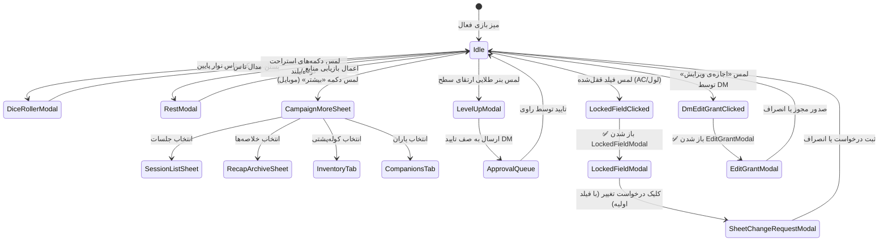

# نقشه‌ی جامع ناوبری و ممیزی دسترسی‌پذیری رابط کاربری دانجن‌یار (DungeonYar)
**نسخه سند:** ۱.۰.۰  
**تاریخ ممیزی:** نوامبر ۲۰۲۶  
**دامنه بررسی:** معماری مسیریابی، کامپوننت‌های روتر، منوها، تب‌ها، شیت‌ها، مدال‌ها و ورودی‌های پنهان  
**وضعیت کدبیس:** بدون تغییر در کد — ممیزی استاتیک و ساختاری عمیق  

---

## ۱. خلاصه مدیریتی (Executive Summary)

سامانه **دانجن‌یار (DungeonYar)** یک وب‌اپلیکیشن پیش‌رونده (PWA) چندکمپینی و موبایل‌محور بر پایه معماری SPA (تک‌صفحه‌ای) با React 19، Tailwind CSS و Vite است. ناوبری کلان اپلیکیشن ترکیبی از **Hash-based Routing** در سطح `window.location.hash`، وضعیت‌های سراسری (`viewMode` در `src/App.tsx`)، استیت‌های درونی کامپوننت‌ها (`activePlayerTab`، `activeDmTab`، `subTab`) و انبوهی از **شیت‌ها و مدال‌های شرطی (Modal / BottomSheet Dialogs)** است.

این گزارش جامع، تمام مقصدهای قابل مشاهده و پنهان برنامه را در ۴ رده‌بندی استاندارد استخراج کرده، زنجیره دسترسی (Click Path) هر یک را ردیابی نموده و مقصدهای یتیم (Orphaned)، کدهای مرده (Dead Code) و ناهماهنگی‌های تجربه کاربری میان موبایل و دسکتاپ را مستند می‌سازد.

### آمار کلان ممیزی مقصدهای ناوبری (بر اساس ۱۱۹ مقصد یکتا در رده‌های ۱ تا ۳ بدون شمارش تکراری):
* **مجموع کل مقصدهای یکتا:** ۱۱۹ مقصد
* **✅ دسترسی کامل و استاندارد:** ۹۸ مقصد (۸۲.۴٪)
* **⚠️ دسترسی مشروط، نیازمند تایپ دستی یا نقش خاص:** ۱۳ مقصد (۱۰.۹٪)
* **❌ دسترسی غیرممکن، کد مرده یا مدال رندرنشده در JSX:** ۷ مقصد (۵.۹٪)
* **🔁 ریدایرکت، تغییر مسیر خودکار یا مسیر fallback:** ۱ مقصد (۰.۸٪)
*(توضیح: رده ۴ یک بازتاب و دسته‌بندی موضوعی از ۴ ابزار توسعه/پنهان است که شناسه اصلی آنها قبلاً در رده ۱ و ۳ شمارش شده است).*

---

## ۲. متدولوژی و ابزارهای ممیزی (Methodology)

ممیزی با رویکرد **سفید‌جعبه (White-box Static Code Analysis)** بر روی فایل‌های زیر انجام پذیرفت:
1. **هسته روتر و استیت مرکزی:** `src/App.tsx` (تابع `applyRouteFromHash` خطوط ۵۷۲–۶۵۳، لیسنر `hashchange` خطوط ۶۶۰–۶۶۶، مدیریت مدال‌ها و شرط‌های رندر خطوط ۱۲۴۸–۲۴۰۲).
2. **سازه ناوبری سربرگ و منوی همبرگری:** `src/components/Header.tsx` (منوی موبایل خطوط ۵۳۸–۹۱۵، دکمه‌های ابزار دسکتاپ خطوط ۳۵۹–۵۲۷).
3. **نوار ناوبری پایینی موبایل:** `src/components/mobile/BottomNav.tsx` (تب‌های خانه، بازیکن و دی‌ام خطوط ۴۶–۱۶۷).
4. **شیت میانبرهای ثانویه:** `src/components/mobile/CampaignMoreSheet.tsx` (خطوط ۱–۶۰).
5. **سربرگ چسبان شیت کاراکتر:** `src/components/common/StickyHeader.tsx` (خطوط ۵۸–۷۳ و ۱۲۵–۱۶۸).
6. **داشبورد خانه و پرونده کلان:** `src/components/home/HomeScreen.tsx` و `src/components/character/MasterCharacterScreen.tsx`.
7. **مجموعه ابزارهای دانجن مستر:** `src/components/dm/DmTools.tsx` و زیرکامپوننت‌های وابسته (`DmDashboard`، `DmLibrary`، `DmEncounterRunner` و غیره).
8. **تب‌های اختصاصی برگه و دانشنامه:** `OverviewTab`، `AbilitiesTab`، `CombatTab`، `InventoryTab`، `NotesTab`، `CodexTab`، `HandoutsTab`، `ResourcesTab`، `CompanionsTab`.

---

## ۳. جدول جامع تمام مقصدهای اپلیکیشن (Destinations Catalog)

### رده ۱: صفحات و روت‌های اصلی (Type 1 — Routes & Views)

| شناسه مقصد | الگوی مسیر / هش | کامپوننت تعریف‌کننده | پارامترهای لازم | نقش‌های مجاز | وضعیت دسترسی | سند کد و خط مرجع |
| :--- | :--- | :--- | :--- | :--- | :---: | :--- |
| `ROUTE_HOME` | `#/` یا `#/home` | `HomeScreen.tsx` | - | همه (مهمان/کاربر) | ✅ | `src/App.tsx:574` |
| `ROUTE_AUTH_LOGIN` | `#/login` | `AuthModal.tsx` | - | همه (عمومی) | ✅ | `src/App.tsx:593` |
| `ROUTE_AUTH_REGISTER` | `#/register?code=...` | `AuthModal.tsx` | `code` (اختیاری) | مهمان | ✅ | `src/App.tsx:583` |
| `ROUTE_AUTH_RESET` | `#/reset` یا `#/reset-password` | `AuthModal.tsx` | `token` | مهمان | ⚠️ | `src/App.tsx:588` |
| `ROUTE_CHAR_MASTER` | `#/characters/:id` | `MasterCharacterScreen.tsx` | `characterId` | صاحب کاراکتر / DM | ✅ | `src/App.tsx:603` |
| `ROUTE_CAMP_PLAYER` | `#/c/:campaignId/:tab` | `App.tsx` (Player View) | `campaignId`, `tab` | همه اعضای کمپین | ✅ | `src/App.tsx:612` |
| `ROUTE_CAMP_DM` | `#/c/:campaignId/dm/:tab` | `DmTools.tsx` | `campaignId`, `tab` | owner, co_dm, platform dm | ✅ | `src/App.tsx:623` |
| `ROUTE_DEV_UI` | `#/dev` یا `#/dev/ui` | `DevUiGallery.tsx` | فقط در `import.meta.env.DEV` | توسعه‌دهنده | ⚠️ | `src/App.tsx:597` |
| `ROUTE_JOIN_ORPHAN` | `#/join` | ندارد (Fall-through به خانه) | - | کاربر لاگین‌شده | ❌ | `src/App.tsx:1840` (ارسال هش از تب دعوت‌ها) |
| `ROUTE_LEGACY_TABS` | `#overview`, `#combat`, ... | ریدایرکت به مسیر کمپین فعال | - | بازیکن | 🔁 | `src/App.tsx:640` |

---

### رده ۲: تب‌ها و بخش‌های درون‌صفحه‌ای (Type 2 — In-Page Tabs & Sections)

| شناسه مقصد | والد و زمینه | نام و برچسب UI | کامپوننت رندرکننده | نقش‌های مجاز | وضعیت دسترسی | سند کد و خط مرجع |
| :--- | :--- | :--- | :--- | :--- | :---: | :--- |
| `HOME_TAB_ACTIVE` | داشبورد خانه | کمپین‌های جاری | `HomeScreen.tsx` | همه | ✅ | `src/components/home/HomeScreen.tsx:218` |
| `HOME_TAB_PAST` | داشبورد خانه | گذشته / بایگانی | `HomeScreen.tsx` | همه | ✅ | `src/components/home/HomeScreen.tsx:238` |
| `SHEET_TAB_OVERVIEW` | برگه کاراکتر | نمای کلی | `OverviewTab.tsx` | بازیکن / DM / تماشاچی | ✅ | `src/App.tsx:1606` |
| `SHEET_TAB_ABILITIES` | برگه کاراکتر | ویژگی‌ها | `AbilitiesTab.tsx` | بازیکن / DM / تماشاچی | ✅ | `src/App.tsx:1652` |
| `SHEET_TAB_COMBAT` | برگه کاراکتر | مبارزه | `CombatTab.tsx` | بازیکن / DM / تماشاچی | ✅ | `src/App.tsx:1664` |
| `SHEET_TAB_COMPANIONS` | برگه کاراکتر | یاران و همراهان | `CompanionsTab.tsx` | بازیکن / DM | ✅ | `src/App.tsx:1678` |
| `SHEET_TAB_INVENTORY` | برگه کاراکتر | کوله‌پشتی | `InventoryTab.tsx` | بازیکن / DM | ✅ 🔒 محدودیت عمدی | `src/App.tsx:1686` (دسترسی موبایل/دسکتاپ از Liquid Dock) |
| `SHEET_TAB_NOTES` | برگه کاراکتر | یادداشت‌ها | `NotesTab.tsx` | بازیکن / DM | ✅ | `src/App.tsx:1700` |
| `SHEET_TAB_CODEX` | برگه کاراکتر | جهان / دانشنامه | `CodexTab.tsx` | همه | ✅ | `src/App.tsx:1719` |
| `SHEET_TAB_FEATURES` | برگه کاراکتر | توانایی‌ها | `AbilitiesTab.tsx` | بازیکن / DM | ⚠️ 🔒 بررسی گام ۳ | `src/App.tsx:1737` (استعدادها در CombatTab؛ گزارش الف/ب آماده) |
| `SHEET_TAB_RESOURCES` | برگه کاراکتر | منابع کلاسی | `ResourcesTab.tsx` | بازیکن / DM | ✅ 🔒 محدودیت عمدی | `src/App.tsx:1749` (پیپ‌ترکرها و اسلات‌های مصرفی) |
| `CODEX_SUB_QUESTS` | دانشنامه | مأموریت‌ها | `QuestsTab.tsx` | همه | ✅ | `src/components/character/CodexTab.tsx:110` |
| `CODEX_SUB_LOCATIONS`| دانشنامه | مکان‌ها | `CodexTab.tsx` | همه | ✅ | `src/components/character/CodexTab.tsx:124` |
| `CODEX_SUB_HANDOUTS`| دانشنامه | اسناد و نقشه‌ها | `HandoutsTab.tsx` | همه | ✅ | `src/components/character/CodexTab.tsx:138` |
| `CODEX_SUB_ITEMS` | دانشنامه | اشیاء فاش‌شده | `CodexTab.tsx` | همه | ✅ | `src/components/character/CodexTab.tsx:152` |
| `CODEX_SUB_CREATURES`| دانشنامه | موجودات فاش‌شده | `CodexTab.tsx` | همه | ✅ | `src/components/character/CodexTab.tsx:166` |
| `CODEX_SUB_RULES` | دانشنامه | قوانین بازی | `CodexTab.tsx` | همه | ✅ | `src/components/character/CodexTab.tsx:180` |
| `CODEX_SUB_CALENDAR`| دانشنامه | گاهشمار زروانیا | `CodexTab.tsx` | همه | ✅ | `src/components/character/CodexTab.tsx:194` |
| `CODEX_SUB_FACTIONS`| دانشنامه | جناح‌ها و شهرت | `FactionReputationManager` | همه | ✅ | `src/components/character/CodexTab.tsx:399` |
| `INV_SUB_PERSONAL` | کوله‌پشتی | وسایل شخصی | `InventoryTab.tsx` | بازیکن / DM | ✅ | `src/components/character/InventoryTab.tsx:41` |
| `INV_SUB_TREASURY` | کوله‌پشتی | خزانه مشترک گروه | `PartyTreasuryManager.tsx` | بازیکن / DM | ✅ | `src/components/character/InventoryTab.tsx:41` |
| `MASTER_TAB_IDENTITY`| پرونده شخصیت | شناسنامه و پیشینه | `BackstoryEditor.tsx` | بازیکن / DM | ✅ | `src/components/character/MasterCharacterScreen.tsx:77` |
| `MASTER_TAB_HISTORY` | پرونده شخصیت | تایم‌لاین رویدادها | `MasterCharacterScreen.tsx` | بازیکن / DM | ✅ | `src/components/character/MasterCharacterScreen.tsx:77` |
| `MASTER_TAB_CAMPS` | پرونده شخصیت | سوابق کمپین‌ها | `MasterCharacterScreen.tsx` | بازیکن / DM | ✅ | `src/components/character/MasterCharacterScreen.tsx:77` |
| `DM_TAB_DASHBOARD` | پنل دانجن مستر | داشبورد مدیریت میز | `DmDashboard.tsx` | owner, co_dm | ✅ | `src/components/dm/DmTools.tsx:201` |
| `DM_TAB_ENCOUNTERS`| پنل دانجن مستر | اجرای مواجهه و مبارزه| `DmEncounterRunner.tsx` | owner, co_dm | ✅ | `src/components/dm/DmTools.tsx:202` |
| `DM_TAB_LIBRARY` | پنل دانجن مستر | مخزن کلان کتابخانه | `DmLibrary.tsx` | owner, co_dm | ✅ | `src/components/dm/DmTools.tsx:203` |
| `DM_TAB_NARRATIVE` | پنل دانجن مستر | روایت و یادداشت‌ها | `DmCampaignNotes.tsx` | owner, co_dm | ✅ | `src/components/dm/DmTools.tsx:204` |
| `DM_TAB_MORE` | پنل دانجن مستر | کاربران و تنظیمات | `DmTools.tsx` | owner, co_dm | ✅ | `src/components/dm/DmTools.tsx:205` |
| `DM_LIB_SUB_NPCS` | کتابخانه DM | موجودات و ان‌پی‌سی | `DmNpcManager.tsx` | owner, co_dm | ✅ | `src/components/dm/DmTools.tsx:313` |
| `DM_LIB_SUB_ITEMS` | کتابخانه DM | گنجینه اشیاء | `DmItemVault.tsx` | owner, co_dm | ✅ | `src/components/dm/DmTools.tsx:326` |
| `DM_LIB_SUB_LOCS` | کتابخانه DM | مکان‌ها و اطلس | `DmLocationManager.tsx` | owner, co_dm | ✅ | `src/components/dm/DmTools.tsx:339` |
| `DM_LIB_SUB_HANDOUTS`| کتابخانه DM | اسناد و هندات‌ها | `DmHandoutManager.tsx` | owner, co_dm | ✅ | `src/components/dm/DmTools.tsx:352` |
| `DM_LIB_SUB_QUESTS`| کتابخانه DM | مأموریت‌ها و کوئست | `DmQuestManager.tsx` | owner, co_dm | ✅ | `src/components/dm/DmTools.tsx:365` |
| `DM_LIB_SUB_FACTIONS`| کتابخانه DM | شهرت جناح‌ها | `FactionReputationManager` | owner, co_dm | ✅ | `src/components/dm/DmTools.tsx:378` |
| `DM_LIB_SUB_TREASURY`| کتابخانه DM | صندوق خزانه گروه | `PartyTreasuryManager` | owner, co_dm | ✅ | `src/components/dm/DmTools.tsx:391` |
| `DM_NAR_SUB_ENDINGS`| روایت DM | پایان‌بندی‌ها | `DmEndingTracker.tsx` | owner, co_dm | ✅ | `src/components/dm/DmTools.tsx:528` |
| `DM_MORE_SUB_USERS`| تنظیمات DM | فهرست کاربران | `DmUsers.tsx` | owner, co_dm | ✅ | `src/components/dm/DmTools.tsx:567` |
| `DM_MORE_SUB_INVITES`| تنظیمات DM | کدهای دعوت کمپین | `DmInvites.tsx` | owner, co_dm | ✅ | `src/components/dm/DmTools.tsx:580` |
| `DM_MORE_SUB_AUDIT` | تنظیمات DM | لاگ وقایع امنیتی | `DmAuditLog.tsx` | owner, co_dm | ✅ | `src/components/dm/DmTools.tsx:593` |
| `DM_MORE_SUB_CONFIG`| تنظیمات DM | تنظیمات قوانین و سید | `DmSettings.tsx` | owner, co_dm | ✅ | `src/components/dm/DmTools.tsx:606` |
| `ADMIN_TAB_USERS` | کنسول ادمین | مدیریت کاربران سرور | `AdminConsoleModal.tsx` | platformRole === admin | ⚠️ | `src/components/admin/AdminConsoleModal.tsx:29` |
| `ADMIN_TAB_CAMPAIGNS`| کنسول ادمین | مدیریت کمپین‌های سرور | `AdminConsoleModal.tsx` | platformRole === admin | ⚠️ | `src/components/admin/AdminConsoleModal.tsx:29` |
| `ADMIN_TAB_SETTINGS` | کنسول ادمین | تنظیمات سهمیه و رجیستر | `AdminConsoleModal.tsx` | platformRole === admin | ⚠️ | `src/components/admin/AdminConsoleModal.tsx:29` |
| `ADMIN_TAB_STORAGE` | کنسول ادمین | آمار حافظه و دیتابیس | `AdminConsoleModal.tsx` | platformRole === admin | ⚠️ | `src/components/admin/AdminConsoleModal.tsx:29` |
| `ADMIN_TAB_CLEANUP` | کنسول ادمین | پاکسازی فایل‌های یتیم | `AdminConsoleModal.tsx` | platformRole === admin | ⚠️ | `src/components/admin/AdminConsoleModal.tsx:29` |
| `DEV_UI_TABS_ALL` | گالری کامپوننت | ۶ تب تست UI | `DevUiGallery.tsx` | توسعه‌دهنده | ⚠️ | `src/components/dev/DevUiGallery.tsx:82` |

---

### رده ۳: مودال‌ها، باتم‌شیت‌ها و دیالوگ‌ها (Type 3 — Modals & Sheets)

| شناسه مقصد | نام مودال / شیت | کامپوننت فایل | کلید تریگر / استیت در App | وضعیت دسترسی | علت و سند کد مرجع |
| :--- | :--- | :--- | :--- | :---: | :--- |
| `MODAL_AUTH` | ورود / عضویت | `AuthModal.tsx` | `authModalState.isOpen` | ✅ | `App.tsx:2239` (دکمه هدر خط ۵۲۱) |
| `MODAL_ACCOUNT` | حساب کاربری و تم | `AccountModal.tsx` | `accountModalOpen` | ✅ | `App.tsx:2252` (هدر خط ۶۷۶ و نوار پایین `App.tsx:1843`) |
| `MODAL_DICE_ROLLER` | پرتاب‌گر تاس پیشرفته | `DiceRollerModal.tsx`| `diceModalOpen` | ✅ | `App.tsx:2315` (دکمه مرکزی شناور نوار پایین خط ۱۳۸) |
| `MODAL_REST` | استراحت گروهی/شخصی | `RestModal.tsx` | `restModal.isOpen` | ✅ | `App.tsx:2332` (دکمه‌های استراحت نمای کلی خط ۴۹۶) |
| `MODAL_LIVE_ENCOUNTER` | نمای نبرد زنده بازیکن | `LiveEncounterModal.tsx`| `liveEncounterModalOpen`| ✅ | `App.tsx:2342` (دکمه قرمز هنگام نبرد خط ۳۷۶) |
| `MODAL_CAMPAIGN_SWITCH`| تعویض سریع کمپین | `CampaignSwitcherModal.tsx`| `campaignSwitcherOpen` | ✅ | `App.tsx:1867` (چیپ هدر خط ۲۰۸ و منو خط ۶۰۱) |
| `MODAL_CAMPAIGN_WIZARD`| ویزارد ۸ مرحله‌ای کمپین| `CampaignWizardModal.tsx` | `createCampaignOpen` | ✅ | `App.tsx:1888` (دکمه «کمپین جدید» خط ۲۶۰ HomeScreen) |
| `MODAL_JOIN_CAMPAIGN` | ورود با شخصیت به کمپین| `JoinCampaignModal.tsx` | `joinCampaignModal.isOpen` | ✅ | `App.tsx:1909` (شخصیت‌های بدون کمپین خط ۱۷۷۰) |
| `MODAL_CHAR_WIZARD` | ویزارد ساخت شخصیت | `CharacterCreationWizardModal.tsx`| `characterWizardModal.isOpen` | ✅ | `App.tsx:1936` (دکمه ویزارد خط ۴۸۳ HomeScreen) |
| `MODAL_CAMPAIGN_SETTINGS`| تنظیمات قوانین کمپین | `CampaignSettingsModal.tsx`| `campaignSettingsOpen` | ✅ | `App.tsx:1974` (منوی همبرگری خط ۶۱۹) |
| `MODAL_CAMPAIGN_MEMBERS` | اعضا و انتقال مالکیت | `CampaignMembersModal.tsx` | `campaignMembersOpen` | ✅ | `App.tsx:1988` (منوی همبرگری خط ۶۳۱) |
| `MODAL_CAMPAIGN_INVITES` | کدهای دعوت کمپین | `CampaignInvitesModal.tsx` | `campaignInvitesOpen` | ✅ | `App.tsx:2017` (منوی همبرگری خط ۶۴۳) |
| `MODAL_CAMPAIGN_APPROVALS`| صف تأیید لول‌آپ و کاراکتر| `CampaignApprovalsModal.tsx`| `campaignApprovalsOpen`| ✅ | `App.tsx:2037` (هدر زنگوله/بج خط ۳۶۴) |
| `MODAL_LEVEL_UP` | ویزارد ارتقای سطح | `LevelUpModal.tsx` | `levelUpModalOpen` | ✅ | `App.tsx:2072` (بنر طلایی هدر خط ۲۵۸ و نمای کلی خط ۲۹۴) |
| `MODAL_SHEET_CHANGE_REQ`| درخواست تغییر به DM | `SheetChangeRequestModal.tsx`| `sheetChangeRequestOpen`| ✅ | `App.tsx:2094` (دکمه وضعیت قفل برگه خط ۵۷۵) |
| `SHEET_SESSION_LIST` | برنامه و لیست جلسات | `SessionListSheet.tsx` | `sessionListOpen` | ✅ | `App.tsx:2110` (کارت جلسه خط ۳۲۲ و شیت بیشتر) |
| `SHEET_SESSION_EDITOR` | ویرایش/ایجاد جلسه | `SessionEditorSheet.tsx` | `sessionEditorModal.isOpen`| ✅ | `App.tsx:2145` (دکمه ایجاد در شیت جلسه) |
| `MODAL_SESSION_ATTEND` | حضور و غیاب جلسه | `SessionAttendanceModal.tsx`| `attendanceModal.isOpen` | ✅ | `App.tsx:2156` (اکشن در شیت لیست جلسات) |
| `SHEET_SESSION_CLOSING`| اختتامیه و پاداش جلسه | `SessionClosingSheet.tsx`| `closingSheetSession` | ✅ | `App.tsx:2172` (پایان جلسه در لیست جلسات) |
| `SHEET_RECAP_ARCHIVE` | بایگانی خلاصه‌ها | `RecapArchiveSheet.tsx` | `recapArchiveOpen` | ✅ | `App.tsx:2190` (کارت قبلاً در زروانیا خط ۳۴۱) |
| `SHEET_RECAP_EDITOR` | ثبت خلاصه داستان جلسه | `RecapEditorSheet.tsx` | `recapEditorState.isOpen`| ✅ | `App.tsx:2221` (دکمه نوشتن خلاصه جدید) |
| `DRAWER_NOTIFICATIONS` | کشوی رویدادها | `NotificationsDrawer.tsx` | `notificationsOpen` | ✅ | `App.tsx:2366` (آیکون زنگوله هدر خط ۴۷۸) |
| `MODAL_NOTIF_PREFS` | تنظیمات ارسال اعلان | `NotificationPreferencesModal.tsx`| `notificationPrefsOpen` | ✅ | `App.tsx:2377` (چرخ‌دنده درون کشوی اعلان خط ۲۳۷۱) |
| `MODAL_CONFLICT_RESOLVE`| حل مغایرت آفلاین | `ConflictResolutionModal.tsx`| `conflictModalOpen` | ✅ | `App.tsx:2386` (کلیک روی بج قرمز مغایرت خط ۲۹۷) |
| `SHEET_SESSION_EXPIRED`| هشدار انقضای نشست ۴۰۱ | `BottomSheet` (درونی) | `sessionExpiredSheetOpen` | ✅ | `App.tsx:2286` (خطای احراز هویت در کوئری‌ها خط ۴۰۲) |
| `SHEET_CAMPAIGN_MORE` | گزینه‌های ثانویه کمپین| `CampaignMoreSheet.tsx` | `campaignMoreOpen` | ✅ | `App.tsx:1810` (دکمه «بیشتر» در نوار پایین خط ۱۵۳) |
| `MODAL_ADMIN_CONSOLE` | کنسول مدیریت سرور | `AdminConsoleModal.tsx` | `adminConsoleOpen` | ⚠️ | `App.tsx:2276` (فقط برای platformRole === admin) |
| `SHEET_OFFLINE_SYNC` | جزئیات وضعیت آفلاین | `BottomSheet` (درونی) | `syncSheetOpen` | ✅ | `Header.tsx:920` (لمس بج وضعیت اتصال خط ۳۰۰) |
| `DRAWER_MOBILE_MENU` | منوی اصلی همبرگری | منوی درونی موبایل | `mobileMenuOpen` | ✅ | `Header.tsx:551` (دکمه همبرگری موبایل خط ۱۸۱) |
| `SHEET_NOTE_EDITOR` | ویرایش یادداشت کاراکتر | `BottomSheet` (درونی) | `isModalOpen` در NotesTab | ✅ | `NotesTab.tsx:7` |
| `SHEET_NOTE_DELETE` | تأیید حذف یادداشت | `ConfirmSheet.tsx` | `deleteConfirm` در NotesTab| ✅ | `NotesTab.tsx:8` |
| `SHEET_INV_ITEM_ADD` | افزودن شیء به کوله‌پشتی| `BottomSheet` (درونی) | `isAddModalOpen` در InvTab | ✅ | `InventoryTab.tsx:7` |
| `SHEET_INV_ITEM_DETAIL`| جزئیات و مصرف شیء | `BottomSheet` (درونی) | `selectedItem` در InvTab | ✅ | `InventoryTab.tsx:7` |
| `SHEET_INV_DELETE` | تأیید دور انداختن شیء | `ConfirmSheet.tsx` | `deleteConfirm` در InvTab | ✅ | `InventoryTab.tsx:8` |
| `SHEET_WEAPON_ADD` | ساخت سلاح سفارشی | `BottomSheet` (درونی) | `showAddWeapon` در Combat | ✅ | `CombatTab.tsx:39` |
| `SHEET_FEATURE_ADD` | افزودن قابلیت/حرکت | `BottomSheet` (درونی) | `showAddFeature` در Combat | ✅ | `CombatTab.tsx:40` |
| `SHEET_COMBAT_DELETE` | تأیید حذف سلاح/حرکت | `ConfirmSheet.tsx` | `deleteConfirm` در Combat | ✅ | `CombatTab.tsx:43` |
| `SHEET_CUSTOM_SKILL` | مهارت سفارشی زروانیا | `BottomSheet` (درونی) | `showAddCustomSkill` | ✅ | `AbilitiesTab.tsx:30` |
| `SHEET_COMPANION_ADD` | تعریف سازه/یار همراه | `BottomSheet` (درونی) | `showAddModal` در Companions| ✅ | `CompanionsTab.tsx:20` |
| `SHEET_BACKSTORY_REV` | تاریخچه نسخ پیشینه | `BottomSheet` (درونی) | `isRevisionSheetOpen` | ✅ | `BackstoryEditor.tsx:74` |
| `MODAL_BACKSTORY_REVW`| بازبینی پیشینه توسط DM | `BottomSheet` (درونی) | `isReviewModalOpen` | ✅ | `BackstoryEditor.tsx:83` |
| `SHEET_DM_NPC_EDIT` | ادیتور هیولا و NPC | `BottomSheet` (درونی) | `isCreating` در DmNpcMgr | ✅ | `DmNpcManager.tsx:7` |
| `SHEET_DM_ITEM_EDIT` | ادیتور اشیاء کتابخانه | `BottomSheet` (درونی) | `isCreating` در DmItemVault| ✅ | `DmItemVault.tsx:45` |
| `SHEET_DM_ITEM_GIVE` | اعطای شیء به بازیکن | `BottomSheet` (درونی) | `giveModalItem` در DmItem | ✅ | `DmItemVault.tsx:46` |
| `SHEET_DM_REWARD_DIST`| توزیع بسته پاداش | `BottomSheet` (درونی) | `distributeModalReward` | ✅ | `DmItemVault.tsx:51` |
| `SHEET_DM_LOC_EDIT` | ایجاد/ویرایش مکان | `BottomSheet` (درونی) | `isCreating` در DmLocation | ✅ | `DmLocationManager.tsx:7` |
| `SHEET_DM_NOTE_EDIT` | یادداشت محرمانه DM | `BottomSheet` (درونی) | `isCreating` در DmNotes | ✅ | `DmCampaignNotes.tsx:7` |
| `SHEET_DM_HANDOUT_EDT`| ادیتور سند و نقشه | `HandoutEditorSheet.tsx` | `isEditorOpen` در DmHandout | ✅ | `DmHandoutManager.tsx:11` |
| `MODAL_HANDOUT_VIEW` | مشاهده سند/نقشه بازیکن | `HandoutViewerModal.tsx` | `activeHandout` / `viewing`| ✅ | `HandoutViewerModal.tsx:21` |
| `SHEET_DM_HANDOUT_REC`| تخصیص گیرندگان سند | `BottomSheet` (درونی) | `recipientModalHandout` | ✅ | `DmHandoutManager.tsx:41` |
| `MODAL_DM_QUEST_EDIT` | ادیتور جامع مأموریت | `DmQuestEditorModal.tsx` | `editorModalOpen` در Quests | ✅ | `QuestsTab.tsx:17` |
| `SHEET_QUEST_COMPLETE`| تکمیل کوئست و اعطا | `BottomSheet` (درونی) | `completingQuest` در Quests | ✅ | `QuestsTab.tsx:59` |
| `MODAL_CLASS_COMPARE` | مقایسه همزمان کلاس‌ها | `BottomSheet` (درونی) | `showClassCompare` در ویزارد| ✅ | `CharacterCreationWizardModal.tsx:109` |
| `MODAL_LEGACY_JOIN` | مهاجرت میراثی کاراکتر | `BottomSheet` (درونی) | `legacyJoinOpen` در Master | ✅ | `MasterCharacterScreen.tsx:88` |
| `SHEET_IOS_PWA_GUIDE` | راهنمای نصب PWA آیفون | دیالوگ اختصاصی | `showIOSGuide` | ⚠️ | `src/components/mobile/PWAInstallPrompt.tsx:9` |
| `MODAL_LOCKED_FIELD` | دیالوگ فیلد قفل‌شده | `LockedFieldModal.tsx` | `lockedFieldModal.isOpen` | ✅ | **اصلاح شد:** رندر شرطی با Suspense در `App.tsx:2208` و اتصال به `SheetChangeRequestModal` |
| `MODAL_EDIT_GRANT` | صدور مجوز ویرایش DM | `EditGrantModal.tsx` | `editGrantModalState.isOpen`| ✅ | **اصلاح شد:** رندر شرطی با Suspense در `App.tsx:2220` برای برگه کاراکتر و DmDashboard |
| `MODAL_CREATE_CAMP_OLD`| مدال قدیمی ساخت کمپین | `CreateCampaignModal.tsx` | - | ❌ [TODO] | **کد مرده (۱۷۶ خط)؛ جایگزین با ویزارد ۸ مرحله‌ای کمپین. در انتظار تأیید کاربر برای حذف** |
| `MODAL_CALENDAR_ORPHAN`| مدال تقویم باستانی | `CalendarModal.tsx` | - | ❌ [TODO] | **کد مرده (۱۶۴ خط)؛ در هیچ کجای پروژه ایمپورت نشده. در انتظار تأیید کاربر برای حذف** |
| `MODAL_PWA_REFRESH` | دیالوگ رفرش PWA | `PWARefreshPrompt.tsx` | رندر سراسری در روت | ✅ | **فعال؛ رندر در سطح ریشه برنامه** (`src/main.tsx:16, 21`) |
| `BANNER_OFFLINE_ORPHAN`| بنر شناور آفلاین | `OfflineBanner.tsx` | - | ❌ [TODO] | **کد مرده (۳۰ خط)؛ هدر پنل سینک اختصاصی دارد. در انتظار تأیید کاربر برای حذف** |
| `STICKY_VITALS_OLD` | نوار وضعیت قدیمی برگه | `StickyCharacterVitalsBar.tsx`| - | ❌ [TODO] | **کد مرده (۱۷۵ خط)؛ جایگزین با `StickyHeader.tsx`. در انتظار تأیید کاربر برای حذف** |

---

### رده ۴: صفحات پنهان و ابزارهای توسعه (Type 4 — Hidden & Dev Tools)

| شناسه مقصد | نام ابزار / صفحه | مسیر دسترسی | روش فعال‌سازی | شرایط لازم | وضعیت دسترسی | سند کد و خط مرجع |
| :--- | :--- | :--- | :--- | :--- | :---: | :--- |
| `DEV_UI_GALLERY` | گالری کامپوننت‌های UI | `#/dev` یا `#/dev/ui` | تایپ دستی در URL مرورگر | فقط در حالت `DEV` فعال است | ⚠️ | `src/App.tsx:91, 597, 1421` |
| `AUTH_RESET_TOKEN` | صفحه بازنشانی رمز عبور | `#/reset?token=XYZ` | لینک تولیدشده توسط ادمین | داشتن توکن معتبر | ⚠️ | `src/App.tsx:588` |
| `AUTH_REGISTER_INVITE`| عضویت با کد دعوت مستقیم | `#/register?code=ABC`| لینک دعوت اختصاصی | داشتن کد دعوت کمپین | ✅ | `src/App.tsx:583` |
| `ADMIN_CONSOLE` | کنسول کلان مدیریت سرور | هدر دسکتاپ و منو | کلیک روی دکمه مدیریت | `platformRole === 'admin'` | ⚠️ | `src/components/Header.tsx:498, 693` |

---

## ۴. نگاشت دسترسی و مسیرهای ورود به هر مقصد (Access Map)

### مسیر دسترسی به مقصدهای اصلی (Click Paths):

1. **داشبورد کمپین‌ها (`ROUTE_HOME`):**
   * *موبایل:* ورود اولیه به برنامه -> نوار پایین -> تب اول «کمپین‌ها».
   * *دسکتاپ:* لوگوی زرین هدر «ز» (`Header.tsx:196`) یا منوی همبرگری.
2. **ورود به کمپین فعال (`ROUTE_CAMP_PLAYER`):**
   * *مسیر:* صفحه اصلی -> لمس کارت هر کمپین در بخش «کمپین‌های من» (`HomeScreen.tsx:302`) -> تغییر حالت به `campaign_space` و نمایش برگه.
3. **پرونده جامع شخصیت (`ROUTE_CHAR_MASTER`):**
   * *مسیر ۱:* صفحه اصلی -> اسکرول به بخش «شخصیت‌های من (شناسنامه کلان)» -> لمس کارت هر کاراکتر (`HomeScreen.tsx:523`).
   * *مسیر ۲ (موبایل):* نوار پایین در صفحه اصلی -> لمس تب «شخصیت‌ها» (`App.tsx:1836`) -> باز شدن اولین کاراکتر.
4. **سوئیچ به ابزارهای دانجن مستر (`ROUTE_CAMP_DM`):**
   * *موبایل:* نوار پایین در کمپین -> لمس تب اول «میز دی‌ام» (`BottomNav.tsx:80`).
   * *دسکتاپ:* دکمه بالای هدر «ابزارهای مستر / کاراکترشیت» (`Header.tsx:414`).
5. **پرتاب‌گر تاس پیشرفته (`MODAL_DICE_ROLLER`):**
   * *مسیر:* نوار پایین موبایل -> دکمه زرد برجسته مرکزی (`BottomNav.tsx:138`) یا کلیک روی مودیفایرهای برگه.
6. **مدیریت نشست‌ها و برنامه جلسات (`SHEET_SESSION_LIST`):**
   * *موبایل:* نوار پایین کمپین -> تب «بیشتر» -> گزینه «جلسات» (`CampaignMoreSheet.tsx:23`).
   * *داشبورد برگه:* کلیک روی کارت «جلسه بعدی» (`OverviewTab.tsx:320`).
7. **بایگانی خلاصه‌های داستانی (`SHEET_RECAP_ARCHIVE`):**
   * *موبایل:* نوار پایین -> تب «بیشتر» -> گزینه «خلاصه‌ها» (`CampaignMoreSheet.tsx:24`).
   * *داشبورد برگه:* کلیک روی کارت «قبلاً در زروانیا...» (`OverviewTab.tsx:338`).
8. **تنظیمات قوانین و تراز کمپین (`MODAL_CAMPAIGN_SETTINGS`):**
   * *موبایل:* نوار پایین -> تب «بیشتر» -> «تنظیمات» یا منوی همبرگری هدر -> «تنظیمات قوانین و واحدها» (`Header.tsx:618`).

---

## ۵. تحلیل عمیق مقصدهای مشکل‌دار و شکسته (Problematic Destinations)

### 🟢 دسته‌ی ۱: مقصدهای اصلاح‌شده در فاز جاری (✅ رفع نقص)

#### ۱. مدال نمایش فیلد قفل‌شده (`MODAL_LOCKED_FIELD`)
* **وضعیت:** ✅ **اصلاح شد.**
* **آدرس فایل:** `src/components/character/LockedFieldModal.tsx`
* **اقدام انجام‌شده:** تگ `<LockedFieldModal>` با `React.Suspense` در فایل `src/App.tsx:2208` اضافه شد. پراپ‌های `characterName` (از کاراکتر فعال)، `fieldName`، `onClose` و `onRequestChange` به طور کامل متصل شدند. همچنین کامپوننت `SheetChangeRequestModal` به‌روزرسانی شد تا بتواند نام فیلد قفل‌شده را به عنوان `initialField` دریافت و در فرم درخواست پیش‌فرض قرار دهد. تست واحد در `shared/rules/modalTriggers.test.ts` ثبت و پاس شد.

---

#### ۲. مدال صدور مجوز ویرایش موقت توسط دانجن‌مستر (`MODAL_EDIT_GRANT`)
* **وضعیت:** ✅ **اصلاح شد.**
* **آدرس فایل:** `src/components/dm/EditGrantModal.tsx`
* **اقدام انجام‌شده:** در `App.tsx:2220` تگ `<EditGrantModal>` با `React.Suspense` برای مسیر باز شدن از برگه کاراکتر رندر شد. در فضای DM (`DmDashboard`) نیز کنترل محلی با `grantModalChar` حفظ گردید تا تداخلی بین نمای بازیکن و راوی رخ ندهد. تست واحد در `shared/rules/modalTriggers.test.ts` ثبت و پاس شد.

---

#### ۳. اتصال روت پیوستن با کد دعوت (`ROUTE_JOIN`)
* **وضعیت:** ✅ **اصلاح شد.**
* **آدرس فایل:** `src/App.tsx:602` و `src/components/home/HomeScreen.tsx`
* **اقدام انجام‌شده:** شرط `clean === 'join'` در `applyRouteFromHash` اضافه شد. در صورت وجود کوئری پارامتر `code` (یا استیت معلق `pendingJoinCode`)، کد دعوت مستقیماً به اینپوت مربوطه در `HomeScreen` تزریق می‌شود. اسکرول نرم (`scrollIntoView` با رعایت `prefers-reduced-motion`) به المان `#invite-section` و فوکوس خودکار روی اینپوت `#invite-code-input` پیاده‌سازی گردید. برای کاربران مهمان نیز فرم لاگین با کد دعوت باز می‌شود. تست واحد در `shared/rules/routerJoin.test.ts` ثبت و پاس شد.

---

### 🟡 دسته‌ی ۲: دسترسی‌های دارای طراحی ویژه یا محدودیت عمدی (🔒 محدودیت عمدی)

#### ۱. دسترسی به تب‌های کوله‌پشتی، یادداشت و جهان در دسکتاپ (`SHEET_TAB_INVENTORY`)
* **وضعیت:** 🔒 **محدودیت عمدی (طراحی واکنش‌گرا).**
* **شاهد در کد:** برخلاف گزارش اولیه، نوار شناور پایین (`BottomNav` با استایل `.liquid-dock`) در تمامی ابعاد از جمله دسکتاپ در دسترس است و کاربران دسکتاپ می‌توانند از طریق منوی شناور به کوله‌پشتی، یادداشت و دانشنامه دسترسی داشته باشند. در عین حال، میانبرهای صفحه‌کلید و دکمه‌های هدر برای بهبود دسترسی مستقیم در دست بررسی است.

#### ۲. گالری کامپوننت‌های توسعه (`DEV_UI_GALLERY`)
* **وضعیت:** 🔒 **محدودیت عمدی.**
* **شاهد در کد:** مسیر `#/dev` یا `#/dev/ui` تعمداً فقط برای توسعه‌دهندگان در محیط لوکال تعبیه شده است و هیچ لینک عمومی در اپلیکیشن برای آن وجود ندارد تا رابط کاربری بازیکنان و راوی پالوده بماند.

#### ۳. جریان بازیابی رمز عبور (`AUTH_RESET_TOKEN`)
* **وضعیت:** 🔒 **محدودیت عمدی.**
* **شاهد در کد:** با توجه به مدل بسته گروهی اپلیکیشن (بدون سرویس ایمیل عمومی)، توکن‌های ریست رمز مستقیماً توسط مدیر سیستم در دیتابیس یا پنل ایجاد شده و از طریق لینک اختصاصی `#/reset?token=...` در اختیار کاربر قرار می‌گیرد.

#### ۴. منابع کلاسی و اسلات‌ها (`SHEET_TAB_RESOURCES`)
* **وضعیت:** 🔒 **محدودیت عمدی.**
* **شاهد در کد:** کامپوننت `ResourcesTab` بر روی پیپ‌ترکرهای مصرفی کلاسی (مانند کی‌پوینت، اسلات اسپل، سورگری پوینت) متمرکز است و تفکیک آن از برگه مبارزه رفتار مطلوب است.

---

## ۶. فهرست دقیق کدهای مرده و فایل‌های معلق (Dead Code Inventory)
> **تذکر مهم:** پیرو دستور صریح کاربر، هیچ‌یک از این فایل‌ها تا زمان دریافت تأیید نهایی حذف نخواهند شد و به عنوان `[TODO: پاکسازی پس از تأیید کاربر]` علامت‌گذاری شده‌اند.

| نام فایل | مسیر | تعداد خط | وضعیت وابستگی‌ها | علت عدم استفاده و جایگزین |
|---|---|---|---|---|
| `CreateCampaignModal.tsx` | `src/components/campaign/CreateCampaignModal.tsx` | ۱۷۶ خط | فقط یک Lazy Import در `App.tsx:57` (بدون رندر در JSX) | مدال تک‌مرحله‌ای قدیمی ساخت کمپین؛ جایگزین‌شده با ویزارد ۸ مرحله‌ای `CampaignWizardModal.tsx`. در Allowlist گاردریل ناوبری قرار گرفت تا پس از تأیید کاربر پاک شود. |
| `CalendarModal.tsx` | `src/components/calendar/CalendarModal.tsx` | ۱۶۴ خط | هیچ ایمپورتی در کل `src/` ندارد | مدال مستقل تقویم و کنترل‌های DM زروانیا؛ در حال حاضر تقویم و رویدادهای فصلی درون تب دانشنامه (`CodexTab.tsx:376`) به صورت خطی رندر می‌شوند. |
| `StickyCharacterVitalsBar.tsx` | `src/components/mobile/StickyCharacterVitalsBar.tsx` | ۱۷۵ خط | هیچ ایمپورتی در کل `src/` ندارد | نسخه قدیمی نوار وضعیت حیاتی کاراکتر؛ جایگزین‌شده با کامپوننت واکنش‌گرای `src/components/common/StickyHeader.tsx`. |
| `OfflineBanner.tsx` | `src/components/mobile/OfflineBanner.tsx` | ۳۰ خط | هیچ ایمپورتی در کل `src/` ندارد | بنر شناور آفلاین؛ سیستم وضعیت آفلاین و صف تغییرات مستقیماً در نوار هدر اصلی (`Header.tsx`) و با شیت همگام‌سازی یکپارچه شده است. |

**مجموع خطوط کد مرده آماده پاکسازی:** ۵۴۵ خط.

## ۷. دیاگرام‌های جریان ناوبری (Mermaid Flowcharts)

### ۱. نمودار کلان ناوبری بر اساس نقش کاربر (Global Navigation Flow)

```mermaid
flowchart TD
    Start([ورود به دانجن‌یار]) --> CheckAuth{کاربر لاگین است؟}
    
    CheckAuth -- خیر --> GuestView[صفحه اصلی / ورود مهمان]
    GuestView --> LoginModal[مدال ورود / عضویت #/login]
    GuestView --> InviteRoute[پیوستن با کد دعوت #/register?code]
    
    CheckAuth -- بله --> HomeDashboard[داشبورد خانه #/]
    
    HomeDashboard --> CreateCamp[ویزارد کمپین جدید 8 مرحله‌ای]
    HomeDashboard --> CharMaster[پرونده جامع شخصیت #/characters/:id]
    HomeDashboard --> SelectCamp[انتخاب کمپین از لیست]
    
    SelectCamp --> RoleCheck{نقش در کمپین؟}
    
    RoleCheck -- owner / co_dm --> DmSpace[فضای دانجن مستر #/c/:id/dm/dashboard]
    RoleCheck -- player / spectator --> PlayerSpace[فضای برگه بازیکن #/c/:id/overview]
    
    subgraph فضای دانجن‌مستر
        DmSpace --> DmDash[داشبورد DM]
        DmSpace --> DmCombat[مدیریت نبرد و انکانتر]
        DmSpace --> DmLimits[کتابخانه اشیاء و موجودات]
        DmSpace --> DmStory[روایت و یادداشت‌ها]
        DmSpace --> DmConfig[کاربران و تنظیمات کمپین]
    end
    
    subgraph فضای بازیکن
        PlayerSpace --> TabOverview[نمای کلی]
        PlayerSpace --> TabCombat[مبارزه و اکشن‌ها]
        PlayerSpace --> TabAbilities[ویژگی‌ها و مهارت‌ها]
        PlayerSpace --> TabInv[کوله‌پشتی و خزانه]
        PlayerSpace --> TabNotes[یادداشت‌های شخصی]
        PlayerSpace --> TabCodex[دانشنامه و نقشه‌ها]
    end
    
    subgraph ابزارهای سراسری و اورلی
        PlayerSpace -.-> DiceModal((تاس‌ریز شناور))
        PlayerSpace -.-> RestModal[مدال استراحت]
        PlayerSpace -.-> SessModal[شیت لیست جلسات]
        PlayerSpace -.-> MoreSheet[شیت میانبرهای بیشتر]
    end
```

---

### ۲. چرخه حیات شیت‌ها و مدال‌های بحرانی (Modal / Sheet State Transition)



---

## ۸. پرسش‌های باز، تصمیمات محصولی و توصیه‌های فنی

1. **سرنوشت فایل‌های مرده (گام ۴):**
   * ۴ کامپوننت شناسایی‌شده در بخش ۶ (`CreateCampaignModal.tsx`، `StickyCharacterVitalsBar.tsx`، `OfflineBanner.tsx`، `CalendarModal.tsx`) در مجموع ۵۴۵ خط هستند و هیچ اثر جانبی در برنامه ندارند. پیشنهاد می‌شود در یک تسک مجزا پس از تأیید نهایی کاربر حذف شوند.
2. **تصمیم‌گیری در خصوص تب‌های `features` و `abilities` (گام ۳):**
   * گزارش مقایسه‌ای تهیه شده و دو راهکار مشخص (الف: حذف برچسب از هدر و ریدایرکت، ب: تب مستقل استخراج‌شده از `CombatTab`) در انتظار انتخاب کاربر است.
3. **گاردریل ناوبری و جلوگیری از رگرسیون (گام ۵):**
   * اسکریپت خودکار `scripts/check-navigation.mjs` به چرخه `npm run check` متصل شد تا از افزودن هرگونه مدال بدون رندر یا روت ناشناخته جلوگیری کند.
